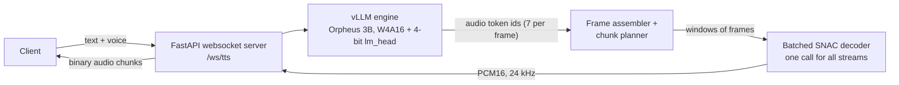
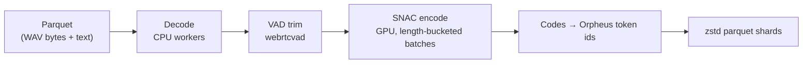

# speech-serving

A realtime streaming speech server (Orpheus 3B on vLLM, SNAC codec, FastAPI websocket) and an audio
tokenization pipeline (parquet → decode → VAD → SNAC encode → shards), built and measured on a single
{{gpu}}. Every number in this README is read from a file in `results/`, which records the GPU,
model, vLLM version and date of each run (vLLM {{vllm}}, torch {{torch}}).

## Headline results

{{t_headline}}

Decode speed per precision (batch size 1, one stream, no server; realtime needs {{rt_tok}} tokens/s):

{{t_precision}}


## Architecture

Serving path. One process owns the websocket server and the SNAC decoder; vLLM's engine core runs in its own
process. All concurrent streams share one vLLM engine (continuous batching) and one batched SNAC decoder.



Tokenization pipeline. CPU worker processes decode and trim; one GPU process encodes; shards go to disk.



## Optimisation ladder

Single-stream decode speed is in the precision table above. Serving-side changes, in order, including the
ones that were rejected. "Max realtime streams" is the highest load level with p95 RTF below 1.0, no gaps
and no errors, tested on that row's levels (screens test 4, 6 and 8 streams only). The full data is in
`results/optimizations.csv`.

{{t_ladder}}


## Key findings

**Decoding is memory-bandwidth-bound; W4A16 plus a 4-bit lm_head crossed realtime.** At batch size 1 every
generated token reads all the weights once, and speed tracks bytes read: bf16 ({{w_bf16}} GiB of weights)
decodes at {{bf16_tps}} tok/s, fp8 ({{w_fp8}} GiB) at {{fp8_tps}}, W4A16 ({{w_w4}} GiB) at {{w4_tps}}. Realtime needs
{{rt_tok}} tok/s per stream ({{rt_ms}} ms per token), so only the 4-bit configurations qualify. A profile of the
W4A16 decode step ({{prof_step}} ms, GPU {{prof_busy}} busy, no idle gaps) showed the bf16 lm_head, a single matrix-vector
product over the {{vocab}}-entry vocabulary, taking {{prof_lmhead}} ms of it ({{prof_lmhead_share}}). Quantizing it too (GPTQ, calibrated on the
model's own generated tokens, lm_head untied from the embedding) brought the step to {{lm_ms}} ms: {{lm_tps}} tok/s, {{tps_ratio}}×
bf16. Word error rate stayed within noise of bf16 (see Quality).

**A measurement artefact was found and corrected (step 1d).** Earlier runs reported W4A16 at {{art_old_tps}} tok/s
({{art_old_ms}} ms/token) and pointed to unexplained overhead. The profile showed the GPU was busy {{prof_busy}} of the time, and
the cause was the measuring script itself: it redirected the engine's stdout/stderr to read the startup log,
which added CPU work to every engine step. That work is hidden when a GPU step is long (bf16 was unaffected) and
exposed when it is short, so all the quantized speeds were too low. The script was fixed and every affected
number re-measured ({{art_new_tps}} tok/s for W4A16). The "fp8 is inefficient at batch 1" hypothesis that rested on the
inflated numbers was withdrawn. Details: `results/step1d_profile.md`.

**SNAC decoding was the first serving bottleneck, and batching fixed it.** With one SNAC call per stream
window on one worker thread, the baseline load test passed only {{base_max}} concurrent streams: the SNAC worker was
100% busy from {{base_snac_sat_n}} streams on and total throughput flattened near {{base_ceiling}} audio-seconds per second. Batching all
streams' windows into one call lifted the throughput ceiling to {{bat_ceiling}} ({{ceiling_x}}×) and the max to
{{bat_max}} streams in the coarse sweep; the fine sweep of the same configuration later showed {{max_n}}.

**The current limit is cross-process GPU time-slicing.** After batching, neither vLLM nor SNAC is saturated
alone: at 8 streams SNAC is only {{snac_busy_8}} busy, and vLLM alone needs {{alone_8}} ms per step (step 6a benchmark). Inside
the server the same step takes {{server_8}} ms, because vLLM's engine core and the SNAC decoder are separate processes
that take turns on the GPU. That lands on the {{rt_ms}} ms realtime budget. Making SNAC cheaper (fp16, CUDA graphs,
larger chunks, waiting to form bigger batches) left vLLM's per-token time unchanged, since the time lost depends on
how often SNAC runs rather than on how much each call does. Running both in one process or under MPS would
address it; neither was possible in the test environment (see the ladder).

**Time to first audio is not time to first speech.** Orpheus begins each utterance with a lead-in of near-silence;
in the {{n_clips}} step 5 clips for the served config audible speech starts a median of about 0.6 s into the audio (`docs/DECISIONS.md`, step 6c).
Cutting time to first audio from {{ttfa1_old}} ms to {{ttfa1_new}} ms at one stream (smaller first chunk) therefore does not
bring speech forward by the same amount. *Proposed fix (not built):* hold back generated frames until the first
frame above a loudness threshold and start streaming from there, which `docs/DECISIONS.md` estimates would bring
first speech forward by about 0.3 s at one stream. The audio would be unchanged apart from the dropped silence.

**The tokenization pipeline is bound by the GPU encoder, and fp16 was rejected because it changes tokens.** The
GPU stage runs at {{gpu_cap}} hours of audio per minute and the slowest CPU stage (VAD) has about {{cpu_headroom}}× that, so adding CPU
cores does not help. The SNAC encoder runs at the full 24 kHz sample rate and is mostly elementwise work
({{prof_elem_share}} of GPU time versus {{prof_gemm_share}} in matrix-multiply convolutions), so it is memory-bound. `torch.compile` on the
encoder fuses those operations: {{compile_x}} faster with {{compile_agree_lo}}–{{compile_agree_hi}}% of codes identical, adopted together with
a padded-sample batch budget. fp16 autocast was +{{fp16_gain}} faster but changes {{fp16_diff_lo}}–{{fp16_diff_hi}}% of the codes; because the codes are the
training data, a faster encoder that silently alters the dataset is not an acceptable trade. Prefetching on a
second thread made things slower (Python's lock starves the GPU launch loop) and was turned off.

{{t_pipeline_runs}}


## Quality

**Method.** `src/speechserve/quality_sentences.txt` holds {{n_sent}} fixed sentences (short, numbers and dates, names,
punctuation and questions, long, technical, two tongue twisters), none in the GPTQ calibration set. Each config
synthesizes every sentence with voice `{{voice}}` for {{n_seeds}} seeds ({{n_clips}} clips per config) through the server's own decode
path. Clips are transcribed with Whisper {{whisper}} and scored with jiwer (WER, CER) after Whisper's English text
normaliser. Because that normaliser treats numbers inconsistently (for example "4:30" against "4.30"), a
format-insensitive WER that also ignores number and ordinal formatting is reported next to it. Differences from bf16
use a paired bootstrap over sentences ({{boot_resamples}} resamples, 95% interval).

{{t_quality}}

**Result.** The 4-bit lm_head config scores {{lm_wer}} against {{bf16_wer}} for bf16: {{lm_vs_bf16}}, and the interval includes zero.
On the format-insensitive metric the figures are {{lm_wer_fmt}} and {{bf16_wer_fmt}}. The final server configuration (early first chunk,
batched decoder) was re-scored against the step 5 run of the same model: {{final_vs_step5}}, within noise. The seed-to-seed change
in WER for the same sentence is {{seed_noise_lo}} to {{seed_noise_hi}} points, larger than the config differences.

**Caveats.** This harness can only detect differences of roughly ±2 WER points (`docs/DECISIONS.md`, step 5). WER measures intelligibility, not
naturalness, prosody or codec artefacts; no listening test or MOS model was run (example clips are in
`results/samples/`). One voice, English only; Whisper itself also makes transcription errors that count against the TTS.
Most of the clips above 20% WER are formatting disagreements, not mispronunciations, and every config mangles the
same tongue twister, so that is a model property, not a quantization one.

## Scaling

`docs/SCALING.md` (generated by `scripts/scaling_math.py`) translates the single-L4 measurements to a larger
scale, with every assumption labelled. At the measured {{max_n}} streams per L4, 100 concurrent streams need
{{sc_gpus_100}} GPUs and 1,000 need {{sc_gpus_1000}} ({{sc_gpus_100_c}} and {{sc_gpus_1000_c}} with one level of margin). Tokenizing {{sc_hours}} hours
of audio is about {{sc_l4h}} L4-hours at the measured pipeline rate. One epoch over that data ({{sc_tokens}} tokens) is about
{{sc_800m}} GPU-hours for an 800M model and {{sc_48b}} for 4.8B at an assumed {{sc_mfu}} MFU. Memory per GPU under DDP, FSDP, HSDP
and tensor parallelism is worked out in the document; no multi-GPU training was run.

## Reproduce

All results were produced on Colab with an L4 runtime. Large files (models, clips, shards) live on Drive under
`/content/drive/MyDrive/speech-infra` and never in git.

1. **Launcher.** Open `notebooks/00_colab_launcher.ipynb` on an L4 runtime. It checks the GPU, mounts Drive, logs in
   to Hugging Face and clones the repo. Colab secrets: `HF_TOKEN` (the Orpheus models are gated; accept their terms
   on Hugging Face first) and `GH_TOKEN` (only needed for a private clone or to push results). Tokens are never
   written to files.
2. **Environment.** `bash scripts/setup_colab.sh` installs the pinned stack from `requirements.txt` (vLLM {{vllm}},
   torch {{torch}}), applies the cuDNN fix described in `docs/DECISIONS.md`, and checks that SNAC decodes on the GPU.
3. **Precision and decode-speed measurements** (steps 1 to 1d):
   ```
   python scripts/step1_generate.py --precision bf16        # also fp8, fp8_kv, fp8_marlin, w4a16
   python scripts/step1d_overhead.py lmhead_w4a16           # one variant per process
   ```
4. **Quantization.**
   ```
   python scripts/make_calib.py                              # calibration set from bf16 generations (Drive)
   bash scripts/setup_quant_venv.sh                          # isolated venv for llm-compressor
   /content/venvs/quant/bin/python scripts/quantize_w4a16.py             # W4A16
   /content/venvs/quant/bin/python scripts/quantize_w4a16.py --lm-head   # W4A16 + 4-bit lm_head (default preset)
   ```
5. **Server** (own tmux window): `python scripts/run_server.py`. Defaults are the final configuration: preset
   `w4a16_lmhead`, batched SNAC decoder, first chunk after 2 frames.
6. **Load test** (final sweep behind the headline table):
   ```
   python scripts/run_loadtest.py --levels 1 4 5 6 7 8 10 12 16 --duration 60 --out results/step6c_final_sweep
   ```
   The step 4 baseline used `python scripts/run_server.py --decoder per_stream --first-wait-frames 4` and the
   default levels.
7. **Quality.**
   ```
   python scripts/run_quality.py --decoder per_stream --first-wait-frames 4          # step 5, all three configs
   python scripts/run_quality.py --presets w4a16_lmhead --run step6c_first_wait2 --decoder batched \
       --first-wait-frames 2 --out results/step6c_quality --baseline-csv results/quality_baseline_clips.csv
   ```
8. **Tokenization pipeline.**
   ```
   python -c "from speechserve.pipeline.download import download; download()"      # LibriTTS-R train-clean-100, local disk
   python scripts/run_pipeline.py --label full --workers 4 --budget-batches --max-batch-samples 4000000 \
       --pin --compile --copy-to-drive
   python scripts/validate_shards.py
   ```
9. **Derived files** (CPU only): `python scripts/scaling_math.py` (docs/SCALING.md and results/scaling.json),
   `python scripts/make_figures.py` (results/figures), `python scripts/make_readme.py` (this file).
10. **Tests** (CPU only): `pip install -e . numpy pytest && pytest`. Tests that need a GPU or vLLM are skipped with a reason.

**Docker.** A `Dockerfile` for the server is included (CUDA 13 base image, versions pinned from `requirements.txt`,
the cuDNN fix, model directory and preset from environment variables). **It has not been built or run**: the
environment this project was developed in has no Docker daemon. Treat it as untested; the base image tag in
particular should be confirmed before building.
```
docker build -t speechserve .
docker run --gpus all -p 8000:8000 -e HF_TOKEN -v /path/to/models:/models:ro speechserve
```
`/path/to/models` must contain `orpheus-3b-w4a16-lmhead/` from step 4.

## Limitations and not done

- **One GPU, one machine.** Every measurement is a single {{gpu}} on Colab, with the load generator on the same
  machine. Capacity at {{max_n}} streams is at the edge (p95 RTF {{rtf_top}}); {{margin_n}} streams leaves margin.
- **Quality evidence is narrow.** One voice (`{{voice}}`), English only, {{n_sent}} sentences, WER only (no
  naturalness measure), quantization calibrated on a small set of the model's own outputs.
- **Time to first speech** is dominated by the lead-in silence; the proposed fix is not implemented.
- **Cross-process GPU time-slicing** (the serving limit) is not resolved: in-process serving and MPS could not be tried.
- **Pipeline:** one dataset ({{pipe_hours}} hours, {{pipe_clips}} clips) on one L4, read from local disk; remote storage and other GPUs not measured.
  Encoded tokens differ slightly from an uncompiled encoder (see findings).
- **No multi-GPU or multi-node training** was run; `docs/SCALING.md` is arithmetic on stated assumptions, not
  measurement, and says nothing about any particular organisation's systems.
- **Docker image not built.** The GitHub Actions workflow runs only the CPU tests; GPU and vLLM paths are verified
  by the Colab runs recorded in `results/`, not by CI.
- Model weights, audio datasets and shards are not in the repository.

## License

MIT, see `LICENSE`. The Orpheus and SNAC models carry their own licenses (check them before reuse); LibriTTS-R is CC BY 4.0.
